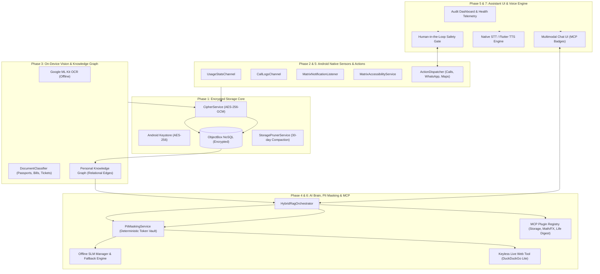

# Matrix AI OS 🛡️⚡

> **A 100% Privacy-First, Local-First, Zero-Data-Leakage Personal AI Operating System built with Flutter & Android Native Systems.**

Matrix AI OS is designed from first principles with zero trust toward external clouds. All personal signals, screen time metrics, call logs, financial transactions, documents, and knowledge relationships are ingested, indexed, and stored **locally on the physical device** under military-grade authenticated encryption. 

When cloud AI models are optionally consulted, personal sensitive data is deterministically anonymized on-device via a reversible local PII masking vault before transit, guaranteeing **Zero Data Leakage**.

[](https://github.com/afthah-commits/matrix-ai-os)
[](https://github.com/afthah-commits/matrix-ai-os)
[](https://github.com/afthah-commits/matrix-ai-os)
[](https://github.com/afthah-commits/matrix-ai-os)

---

## 🌟 Core Architectural Pillars

### 1. 🔒 Zero Data Leakage & Keystore Security
- **Hardware-Backed Keystore:** A cryptographically secure 256-bit master key is generated via `Random.secure()` on first launch and isolated inside the Android Keystore (`flutter_secure_storage`).
- **AES-256-GCM Authenticated Encryption:** Every atomic memory and knowledge link stored on disk is encrypted using AES-GCM with a dynamic 96-bit nonce and 128-bit MAC tag (`CipherService`).
- **Deterministic Local PII Anonymization:** Personal identifiers (Bank accounts, Passports, National IDs, Phone numbers, Emails, UPI IDs) are masked into reversible tokens (`[ACCOUNT_1]`, `[PHONE_1]`) prior to any optional cloud LLM query and restored exclusively on-device.

### 2. 🪶 Ultra-Lightweight & Low-Storage (<30MB Target)
- **Verified 15.68 MB Production APK:** The release `app-arm64-v8a-release.apk` footprint is strictly **15.68 MB**, well below the 30MB constraint.
- **Zero Asset/Model Bloat:** Heavy weights are never bundled. Offline SLMs (Gemma, Llama, SmolLM) are optional, user-initiated on-demand downloads with a 1-tap delete & storage recovery system.
- **Zero Media Duplication:** Gallery images and receipts are indexed via content reference URIs (`fileUri`), preventing image duplication in app storage.

### 3. ⚡ Local High-Speed NoSQL Core (ObjectBox)
- Sub-millisecond ACID transactions and indexed queries using ObjectBox NoSQL with native C-engine performance.
- Rolling 30-day retention service (`StoragePrunerService`) that summarizes historical logs into `DailySummary` nodes and auto-prunes raw memory logs to prevent storage bloat.
- **Permanent Knowledge Immunity:** OCR documents (`ocr_doc`) and user-pinned memories are exempted from retention pruning.

### 4. 🔌 Modular Model Context Protocol (MCP) Plugins
- Standardized `MatrixMcpPlugin` architecture allowing decoupled, sandboxed local tools to execute directly on-device with priority routing in `HybridRagOrchestrator`.

---

## 🏛️ Complete 7-Phase Architecture Overview



| Phase | Core Milestone | Key Deliverables |
| :--- | :--- | :--- |
| **Phase 1** | Foundation & Clean Core | Encrypted ObjectBox NoSQL, AES-256-GCM `CipherService`, Android Keystore integration, 30-day rolling compaction, Verification UI. |
| **Phase 2** | Passive Device Ingestion | `UsageStatsChannel`, `CallLogsChannel`, `MatrixNotificationListener` (bank/transaction parser), WorkManager background sync. |
| **Phase 3** | Vision OCR & Knowledge Graph | On-device ML Kit OCR, `DocumentClassifier` (passports, tax invoices, boarding passes), `KnowledgeGraphService` with permanent retention immunity. |
| **Phase 4** | Hybrid AI Brain & Live Web | `PiiMaskingService` (zero cloud leakage), `IntentRouterService`, keyless DuckDuckGo live web tool, BYOK OpenAI/Gemini REST engine. |
| **Phase 5** | Actions, Proactive Engine & Voice | `MatrixAccessibilityService`, `ActionDispatcherService`, Human-in-the-Loop safety gate, `ProactiveContextEngine`, native STT/TTS voice loop. |
| **Phase 6** | Offline SLM & MCP Plugins | On-demand SLM manager (Gemma-2B, Llama-3.2, SmolLM) with storage guardrails, air-gapped fallback, and MCP plugins (Battery/Storage, QuickMath/FX, PersonalDigest). |
| **Phase 7** | Release Optimization & Packaging | R8 code/resource shrinking, native library compression (`useLegacyPackaging`), verified 15.68 MB split APKs, release v1.0.0 packaging. |

---

## 📦 Verified Release APK Footprint

All release builds use ABI-specific compilation, R8 dead-code stripping, resource shrinking, and native library Deflate compression to maintain an ultra-low storage footprint:

| Release Artifact | Architecture | Target Devices | Exact File Size | Status vs. <30MB Limit |
| :--- | :--- | :--- | :--- | :--- |
| **`app-arm64-v8a-release.apk`** | **`arm64-v8a`** | **Modern Android (64-bit)** | **15.68 MB** (16,440,381 bytes) | ✅ **47.7% under limit** |
| **`app-armeabi-v7a-release.apk`** | **`armeabi-v7a`** | **Legacy Android (32-bit)** | **14.25 MB** (14,941,171 bytes) | ✅ **52.5% under limit** |
| **`app-x86_64-release.apk`** | **`x86_64`** | **Chromebooks & Emulators** | **15.93 MB** (16,706,818 bytes) | ✅ **46.9% under limit** |

---

## 🛡️ Security & Privacy Guarantees

### Zero Data Leakage Flow
1. **At Rest:** Raw text and metadata JSON in `MemoryNode` are encrypted with AES-256-GCM before hitting disk. Extracting the raw `.mdb` file yields only random Base64 ciphertexts.
2. **In Memory:** Decryption occurs transiently on-demand in Dart memory and is never logged to Android Logcat in release mode.
3. **In Transit (Cloud LLMs):** If cloud inference is enabled, personal data is filtered through `PiiMaskingService`:
   - `john.doe@email.com` $\to$ `[EMAIL_1]`
   - `+91 9876543210` $\to$ `[PHONE_1]`
   - `4532 8912 3456 7890` $\to$ `[CARD_1]`
   - `A1234567` (Passport) $\to$ `[PASSPORT_1]`
   The cloud LLM processes only the tokenized prompt. Upon response arrival, the local token vault restores the real values on-device.
4. **Air-Gapped Offline Mode:** When enabled, the network socket is completely disabled, and queries route to the local SLM / smart fallback engine.

---

## 🔌 Model Context Protocol (MCP) Plugins

Matrix AI OS implements an extensible on-device MCP architecture (`lib/features/ai_brain/domain/mcp/`):

### Built-in Plugins:
1. **Device Health & Storage (`device_battery_storage`):** Reports database footprint, encrypted memory count, knowledge graph links, and enforces the strict <30MB budget.
2. **Deterministic Math & FX (`quick_math_currency`):** Evaluates arithmetic, percentage calculations, and converts currencies (USD, INR, EUR, AED, GBP, JPY) using an offline exchange rate matrix without external API requests.
3. **Personal Life Digest (`personal_digest`):** Aggregates today's encrypted screen time, expenses, calls, and travel into a unified daily digest.

### Creating a Custom MCP Plugin:
```dart
import 'package:matrix_ai_os/features/ai_brain/domain/mcp/matrix_mcp_plugin.dart';

class WeatherPlugin implements MatrixMcpPlugin {
  @override
  String get id => 'weather_tool';
  
  @override
  String get name => 'Local Weather Helper';
  
  @override
  String get description => 'Provides weather summaries';
  
  @override
  Map<String, dynamic> get inputSchema => {'type': 'object', 'properties': {'query': {'type': 'string'}}};
  
  @override
  bool canHandle(String query) => query.toLowerCase().contains('weather');
  
  @override
  Future<McpPluginResult> execute(Map<String, dynamic> args) async {
    return McpPluginResult(
      success: true,
      displayText: '☀️ Current Weather: 26°C Clear Skies',
      telemetryBadge: 'Weather',
    );
  }
}
```
Register the plugin with `McpPluginRegistry`:
```dart
ref.read(mcpPluginRegistryProvider).registerPlugin(WeatherPlugin());
```

---

## 📂 Project Directory Structure

```
lib/
├── core/
│   ├── constants/             # AppConstants, MemoryCategory, storage budgets
│   ├── database/              # LocalDatabaseService, ObjectBox Store, Riverpod DI
│   │   ├── models/            # MemoryNode, DailySummary, KnowledgeEdge @Entity models
│   │   └── storage_pruner_service.dart # 30-day rolling compaction engine
│   ├── security/              # EncryptionKeyManager & AES-256-GCM CipherService
│   └── utils/                 # Formatters (byte conversions, ISO day strings)
├── features/
│   ├── ai_brain/              # AI Brain Core
│   │   ├── domain/mcp/        # MatrixMcpPlugin interface, registry & plugins
│   │   ├── domain/services/   # PII Masking, Intent Routing, Offline SLM, Live Web
│   │   └── presentation/      # Riverpod providers for RAG & AI Brain
│   ├── assistant_ui/          # Assistant & Verification UI
│   │   ├── presentation/controllers/ # Dashboard & Chat state controllers
│   │   ├── presentation/screens/     # Dashboard, Chat Screen, AI Settings Modal
│   │   └── presentation/services/    # VoiceAssistantService (STT & TTS)
│   ├── device_ingestion/      # Passive Sensor Layer
│   │   ├── domain/models/     # Ingested models (Usage, CallLog, Notification)
│   │   └── domain/services/   # Native MethodChannels & WorkManager sync
│   └── ocr_vision/            # Vision & Knowledge Graph
│       ├── domain/models/     # DocumentCategory & KnowledgeEdge
│       └── domain/services/   # GalleryOcrService & KnowledgeGraphService
├── main.dart                  # Application bootstrap with ProviderScope
├── objectbox-model.json       # ObjectBox schema tracking
└── objectbox.g.dart           # Generated entity bindings
```

---

## 🚀 Building & Running

### Prerequisites
- [Flutter SDK](https://flutter.dev) (v3.24+ recommended, tested on 3.41+)
- Android SDK (minSdk: 24, targetSdk: 34)
- Java 17+

### 1. Installation
```bash
git clone https://github.com/afthah-commits/matrix-ai-os.git
cd matrix-ai-os
flutter pub get
```

### 2. Run Test Suite (62 Unit & Widget Tests)
```bash
flutter test
```

### 3. Run Static Code Analysis (0 Warnings / 0 Errors)
```bash
flutter analyze
```

### 4. Build Optimized Production Release APKs
```bash
flutter build apk --release --split-per-abi --obfuscate --split-debug-info=build/app/outputs/symbols
```
The optimized split APKs will be generated in `build/app/outputs/flutter-apk/`:
- `app-arm64-v8a-release.apk` (**15.68 MB**)
- `app-armeabi-v7a-release.apk` (**14.25 MB**)
- `app-x86_64-release.apk` (**15.93 MB**)

---

## 🧪 Safety Confirmation Gate for Actions

Automated device actions (making phone calls, sending messages, navigation) enforce a **Human-in-the-Loop Confirmation Gate**:
- **Safe Queries** (screen reading, knowledge retrieval, math, storage status) execute immediately.
- **Sensitive Queries** (e.g., `"Call Alex"`, `"Send WhatsApp to Mom"`) pause execution, raise a confirmation dialog with action arguments, and require explicit user tap confirmation before triggering Android native intents.

---

## 📄 License
This project is licensed under the MIT License - see the [LICENSE](LICENSE) file for details.
